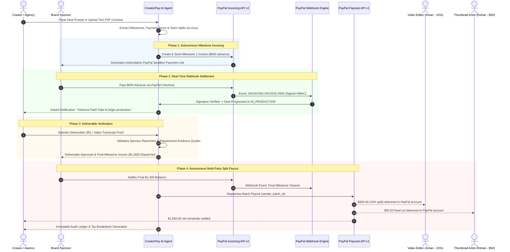

<div align="center">

# 🚀 CreatorPay AI
### *Autonomous AI Dealmaker & Settlement Co-Pilot for Creators, SMBs & Agencies*

[](https://creator-pay-ai.vercel.app/login?mode=judge)
[](https://developer.paypal.com/)
[-black?style=for-the-badge&logo=next.js)](https://nextjs.org/)
[](https://supabase.com/)
[](https://console.groq.com/)
[](https://www.typescriptlang.org/)
[](tests)
[](LICENSE)

<br/>

**Built for the PayPal AI Hackathon 2026**

[🌐 Live Hosted App](https://creator-pay-ai.vercel.app/login?mode=judge) • [🏆 Devpost Submission](https://devpost.com) • [💻 GitHub Repository](https://github.com/ius-sharma/CreatorPay-AI)

</div>

---

> [!IMPORTANT]
> ### ⚖️ Hackathon Judging & Live Testing Access
> A dedicated, pre-confirmed sandbox account has been provisioned for judges with its own isolated workspace and test environment:
> - **Live App URL:** [https://creator-pay-ai.vercel.app/login?mode=judge](https://creator-pay-ai.vercel.app/login?mode=judge)
> - **Judge Test Email:** `judge@creatorpay.example`
> - **Judge Password:** `CpJ-mfUsHHC9BrHLnuff24YiCca2UX9xXxGP9mJlkQ-9!`
> - **Direct Shortcut:** Clicking the link above pre-fills the judge portal — simply enter the password above to evaluate the complete end-to-end deal lifecycle!

---

## 📌 Executive Summary

Solo creators, creative collectives, and digital agencies spend over **30% of their billable hours** trapped in manual financial administration:
- Converting unstructured contract emails and PDFs into formal milestone invoices
- Chasing delayed sponsor payments and manually reconciling bank transfers
- Manually calculating and routing revenue splits to editors, animators, and thumbnail designers

**CreatorPay AI** solves this friction entirely using an autonomous agentic financial architecture powered by the **PayPal Developer Platform** and **Groq LLM Structured Tool-Calling**:

```
┌────────────────────────┐      ┌─────────────────────────┐      ┌─────────────────────────┐
│   Natural Language     │ ───► │    PayPal Invoicing     │ ───► │  Real-time Webhook      │
│   Contract / PDF       │      │    API v2 (Advance 30%) │      │  Clearance Notification │
└────────────────────────┘      └─────────────────────────┘      └─────────────────────────┘
                                                                              │
                                                                              ▼
┌────────────────────────┐      ┌─────────────────────────┐      ┌─────────────────────────┐
│   Immutable Split      │ ◄─── │    PayPal Payouts       │ ◄─── │  AI Multi-Modal Proof   │
│   Tax & Audit Ledger   │      │    API v1 (Team Splits) │      │  Deliverable Check      │
└────────────────────────┘      └─────────────────────────┘      └─────────────────────────┘
```

---

## 🔄 End-to-End Workflow Architecture



---

## 🛠️ PayPal Developer Platform Deep Dive

CreatorPay AI deeply integrates three core primitives of the **PayPal Developer Platform**:

### 1. PayPal Invoicing API (v2)
* **Endpoint:** `/v2/invoicing/invoices`
* **Autonomous Capability:** Parses natural contract language into strictly validated, compliant milestone invoices without manual data entry.
* **Payload Engineering:**
  - Automated line-item breakdown (e.g., *"Milestone 1: 30% Initial Production Advance"*).
  - Explicit merchant configuration (`PAYPAL_BUSINESS_EMAIL`), dynamic currency support (`USD`, `EUR`, `GBP`, `CAD`, `AUD`).
  - Strict deduplication lease locks preventing redundant invoices upon network retries.

### 2. PayPal Webhooks Engine
* **Endpoint:** `/api/paypal/webhook`
* **Events Processed:**
  - `INVOICING.INVOICE.PAID`: Signals that the brand sponsor has cleared payment.
  - Automatically updates the state machine from `PENDING_INVOICE` to `IN_PRODUCTION`.
* **Security & Reliability:**
  - Cryptographic PayPal header signature validation (`PAYPAL-TRANSMISSION-SIG`, `PAYPAL-CERT-URL`).
  - Webhook ID matching and database-backed event deduplication (`creatorpay_webhook_events`) to prevent duplicate processing.

### 3. PayPal Payouts API (v1)
* **Endpoint:** `/v1/payments/payouts`
* **Autonomous Capability:** Disburses instant, multi-party collaborator split payments immediately upon final project deliverable approval.
* **Payload Engineering:**
  - Idempotent batch transactions using deterministic `sender_batch_id` and item references.
  - Automated calculation of percentage cuts (`15%`) and fixed fees (`$50`), while guaranteeing that sum of splits never exceeds net invoice amounts.
  - Generates immutable financial audit entries tracking recipient PayPal receiver emails, settlement status, and PayPal transaction IDs.

---

## 💻 Tech Stack & Architectural Highlights

| Layer | Technology | Details |
| :--- | :--- | :--- |
| **Frontend Framework** | **Next.js 14** (App Router) | High-performance React 18, React Server Components (RSC), SSR |
| **Language** | **TypeScript 5.6** | Strict type safety for PayPal REST schemas and financial calculations |
| **Styling & UI** | **Tailwind CSS 3.4** | Custom bespoke fintech dark-mode palette with responsive glassmorphism |
| **Visuals & Motion** | **GSAP & Three.js** | Interactive 3D graphics, smooth scroll, and financial state transitions |
| **Database & Auth** | **Supabase (PostgreSQL 15)** | Row Level Security (RLS), multi-tenant isolation, atomic RPC functions |
| **AI Intelligence** | **Groq LLM Engine** | Structured output parsing with exact evidence citation verification |
| **PDF Processing** | **PDF.js Worker** | Local in-browser contract parsing (OCR-free, client-side extraction) |
| **Payment Gateway** | **PayPal Developer Platform** | Invoicing API v2, Payouts API v1, Webhooks Engine (Sandbox) |
| **Hosting & CI/CD** | **Vercel Edge Platform** | Zero-downtime deployment, HTTPS SSL, and serverless API execution |

---

## 🧪 3-Minute Testing Guide for Judges

Follow these simple steps to evaluate the live demo:

### Step 1: Access the Judge Portal
1. Open [https://creator-pay-ai.vercel.app/login?mode=judge](https://creator-pay-ai.vercel.app/login?mode=judge)
2. The judge email (`judge@creatorpay.example`) is prefilled.
3. Enter password: `CpJ-mfUsHHC9BrHLnuff24YiCca2UX9xXxGP9mJlkQ-9!` and click **Log In**.

### Step 2: Contract Ingestion & AI Term Extraction
1. Click **New Deal** on the top navigation.
2. Select **Use Sample Contract** or paste your own deal text:
   > *"Acme Corp offers USD 2,000 for a 60-second sponsor video segment. Pay 30% advance ($600) and 70% ($1,400) upon completion. Aman (aman.editor@paypal-sandbox.com) receives a 15% editor cut."*
3. Click **Analyze Contract**.
4. Observe the Groq AI agent parsing the prompt into structured milestone terms with verifiable source quotes.

### Step 3: Autonomous Milestone Invoice Generation
1. Click **Confirm Terms & Create Deal**.
2. Click **Generate Advance Invoice (30%)**.
3. CreatorPay invokes the **PayPal Invoicing API v2** and returns a genuine PayPal sandbox payment URL.

### Step 4: Real-Time Webhook Verification
1. Open the generated PayPal sandbox link in an incognito window.
2. Log in with a PayPal Sandbox Personal Buyer Account to complete payment.
3. Return to the CreatorPay dashboard — notice the milestone automatically marks as **PAID** via real-time webhook events!

### Step 5: Deliverable Verification & Team Payouts
1. Submit deliverable evidence (e.g. video transcript with sponsor segment).
2. The AI verification engine confirms compliance and unlocks the final payout stage.
3. Trigger **Execute Multi-Party Payout** to dispatch instant split payments to collaborators via the **PayPal Payouts API v1**.
4. Review the generated **Audit Ledger** with authoritative PayPal transaction IDs.

---

## 🛡️ Security & Engineering Rigor

* **58 Automated Unit & Integration Tests:** Validates contract extraction, database transactions, signature verification, and PayPal error handling (`npm test`).
* **Authoritative Row Level Security (RLS):** All deal records, invoice links, and audit entries are strictly isolated to authenticated user sessions.
* **HMAC Webhook Verification:** Prevents unauthorized external requests from falsifying milestone payment states.
* **Server-Only Secrets:** All sensitive credentials (`PAYPAL_CLIENT_SECRET`, `SUPABASE_SECRET_KEY`, `GROQ_API_KEY`) run exclusively in serverless Node.js runtimes.

---

## 📄 License & Attribution

Distributed under the **MIT License**. Developed by **Ayush Sharma** for the **PayPal AI Hackathon 2026**.
