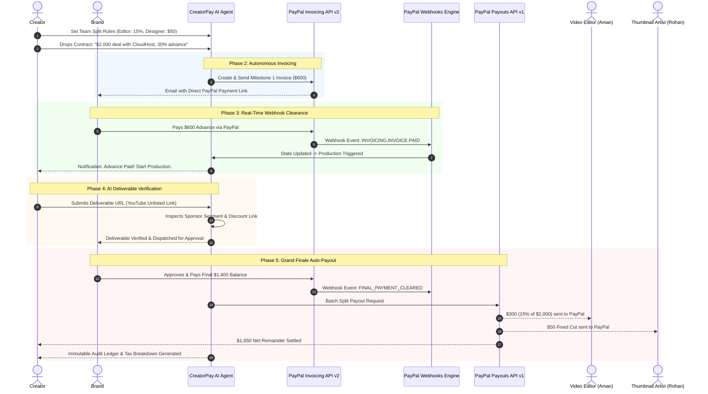

## Sandbox collaborator payouts (Phase 4)

After every milestone has verified PayPal payment records and the latest deliverable has human approval, map each collaborator to a distinct owned generated Personal sandbox account (sb-…@personal.example.com). The original contract recipient remains unchanged; this is an explicit sandbox test mapping. Review the USD amounts before preparing: the persisted payout plan is immutable. Confirm the recipients and send from the local browser session that owns the deal. USD is the only enabled payout currency in this stage.

The server rechecks authoritative paid invoices before sending, validates split totals, and uses a database lease plus a stable sender_batch_id and sender_item_id. A timeout retries the same plan; duplicate-batch responses can recover the original batch. Ambiguous requests older than 28 days are blocked to stay within PayPal's 30-day deduplication window. The app never automatically creates a second batch for failed, unclaimed or returned items: refresh/reconcile the original batch. Incorrect locked mappings require manual reconciliation before any new workflow is introduced.

Submission/PENDING is not settlement. Refresh performs an authenticated PayPal GET, matches every item to its receiver, amount, currency and sender ID, and records settlement only for SUCCESS items with transaction IDs. Payout status is refreshed manually, not via payout webhooks in this stage. SQLite persists batch IDs, item IDs, transactions and deduplicated audit entries. Returned payouts clear settled state. The creator's retained share is an estimate before PayPal fees, not a separate payout or a verified wallet balance. Synthetic seed audit rows remain demo data.

## Deliverable evidence review (Phase 3)

After a verified advance, submit the actual transcript (20–20,000 characters), description (up to 5,000 characters), and optional HTTPS video reference. Text is sent to Groq; URLs are not fetched. Each confirmed deliverable is checked with exact source quotes. Missing content blocks approval; uncertainty requires human inspection. AI does not verify actual video duration, visuals, publication or authenticity. The reviewer must personally check those and confirm all requirements before approving the latest review. Approved submissions are locked. The final invoice requires both the verified advance and this explicit human approval; it uses the same persisted idempotent invoice workflow. PayPal's signed webhook confirms final payment. Review history (last 10), human approval and payment records persist in SQLite. Reviews share existing development-only AI limits; session ownership applies to both review and invoicing.

Live model smoke checks: missing Acme content → changes required; corrected sponsor transcript with a claimed 60-second duration → human review. These are synthetic text tests, not video verification.

# 🚀 CreatorPay AI
### Current implementation status — Phase 2

New contracts use **Groq** for structured extraction, exact source quotes, clarification flags and a user confirmation step. Monetary calculations and schema validation run on the server. Analysis/confirmation does not execute payments. The first milestone can now create a **real PayPal sandbox invoice** with a PayPal-generated payment link. Signed payment events are checked against authoritative invoice details and PayPal transaction records; manually recorded external payments cannot mark a milestone paid. Seeded deals are explicitly illustrative. Deliverable verification, final invoicing and collaborator payouts remain disabled pending later stages; broader claims below describe the planned product.

#### PayPal sandbox payment test

Configure `PAYPAL_ENVIRONMENT=sandbox`, sandbox app credentials, `PAYPAL_BUSINESS_EMAIL`, a stable random `CONTRACT_SIGNING_SECRET`, and `PAYPAL_WEBHOOK_ID`. Live mode is deliberately disabled. New deals require confirmation in the same browser session to create invoices. First-milestone invoicing currently supports USD, EUR, GBP, CAD and AUD. Invoice notifications are disabled; share/open the PayPal-generated sandbox payment link yourself.

1. Run the app locally and `npm run webhook:relay` in another terminal. The relay defaults to port 3030 and forwards only `POST /api/paypal/webhook` to app port 3000. Set `WEBHOOK_APP_PORT` when using a different app port.
2. Start an HTTPS tunnel to the **relay**, e.g. `.tools/cloudflared.exe tunnel --no-autoupdate --url http://127.0.0.1:3030 --protocol http2`. Exposing the full app publicly is not supported yet: authentication and multi-user isolation are still pending.
3. Register the full endpoint using `node scripts/paypal-webhook.cjs https://YOUR-HOST/api/paypal/webhook`. This writes the registered webhook ID privately to `.env.local`; restart the app afterwards. The helper updates this project's existing webhook when its URL changes and does not remove unrelated webhooks.
4. Analyse/review/confirm a contract, create its advance invoice, and open the sandbox payment link. Log in using a separate **Personal sandbox buyer account** from PayPal Developer Dashboard, not the merchant account or a real PayPal account.
5. After actual sandbox payment, the dashboard refreshes every five seconds. It displays Paid only after verified webhook processing, with transaction IDs. No payment-simulation button can mark a real invoice paid.

Quick tunnels are temporary: keep the app, relay and tunnel processes running during testing. Their hostname changes on restart, so re-register the endpoint if necessary. For judging deployment use a stable HTTPS host with persistent storage and authentication. PayPal's event simulator is not evidence of a real paid invoice; exercise actual sandbox checkout.

**Persistence and retries:** SQLite stores deals, invoice IDs, payment transaction IDs and webhook deduplication records in `.data/creatorpay.sqlite` (ignored by Git). Configure `CREATORPAY_DB_PATH` for persistent hosting disk; ephemeral/serverless disk and separate replicas are not supported. Stable invoice numbers, persisted draft IDs and a database lease prevent duplicate invoices on retries. Invoice search recovers interrupted creation; failed sending leaves a draft for retry. Database updates and processed event IDs commit atomically. Resetting demo data preserves confirmed deals and their payment history.

#### Enable Groq locally

1. Create a key at https://console.groq.com/keys.
2. Add `GROQ_API_KEY=...` to your private `.env.local`. Never paste keys into chat, commit them, or use a `NEXT_PUBLIC_` prefix.
3. Set `GROQ_MODEL=openai/gpt-oss-120b` (default, requires model access).
4. Restart `npm run dev`, then open `/dashboard` and choose **Analyze Contract**.

Example contract:

> Acme offers USD 2,000 for a 60-second sponsor segment. Bill finance@acme.example. Pay 30% advance and 70% after approval. Deliver by 2026-11-01. Aman, editor, aman@team.example, receives 15% of the total.

The expected computed amounts are USD 600 advance, USD 1,400 final, USD 300 to Aman and USD 1,700 retained before fees/taxes. Review every term and source quote, then confirm. `.example` addresses are illustrative, not payment recipients. For missing information, edit the input or append an explicit clarification and analyse again. Editing input dismisses the old review. Reviews expire after 30 minutes; restarting invalidates them unless a stable `CONTRACT_SIGNING_SECRET` is configured.

**Limits:** 12,000 contract characters, 10 analysis attempts per anonymous browser session per UTC day, 10 seconds between attempts, 100 total attempts per server process/day. Attempted provider calls count even if unsuccessful. These are in-memory development guardrails, not durable per-user quotas: cookie deletion/restart can reset limits, and replicas do not share counters. Add authentication, a shared persistent quota store and a provider spend cap before exposing this app publicly. Contract text is sent to Groq; use synthetic contracts for development. Dates are preserved as written rather than inventing a calendar interpretation.

**Phase boundaries:** advance invoicing, verified payment tracking, Groq transcript/description reviews and human-approved final invoicing are enabled. Collaborator sandbox payouts are now enabled through the explicit reviewed payout plan. Final invoicing currently supports exactly two milestones. Contract reviews and analysis quotas are still session/process scoped; confirmed deals and payments persist in SQLite. Saved team rules are opt-in, separately labelled, and overridden by explicit contract splits. Incomplete split recipients require clarification; no recipient is invented.

Run `npm test` for contract, provider error and API workflow checks, and `npm run build` for the production build. Live model accuracy must be evaluated with a valid Groq key; offline tests use mocked responses and are not evidence of live accuracy.

### *Autonomous AI Dealmaker & Settlement Co-Pilot for Creators, SMBs & Agencies*

[](https://developer.paypal.com/)
[-black?style=for-the-badge&logo=next.js)](https://nextjs.org/)
[](https://www.typescriptlang.org/)
[](https://tailwindcss.com/)
[](LICENSE)

---

## 📌 Executive Summary

**CreatorPay AI** is an autonomous financial dealmaker and settlement co-pilot engineered for the $250B+ creator and digital merchant economy. 

Solo creators, creative collectives, and digital agencies spend over 30% of their working hours trapped in administrative friction: converting messy contract discussions into invoices, manually tracking bank/card payments, chasing late brand sponsorships, and manually calculating and distributing revenue splits to video editors, thumbnail artists, and collaborators.

**CreatorPay AI solves this end-to-end using the PayPal Developer Platform and AI Agent tool-calling:**
1. **Parses unstructured deal contracts/emails** into milestone payment terms using LLMs.
2. **Autonomously generates and sends PayPal Milestone Invoices** (e.g., 30% advance) via the **PayPal Invoicing API (v2)**.
3. **Monitors payment clearance in real time** via **PayPal Webhooks** (`INVOICING.INVOICE.PAID`).
4. **Verifies deliverable completion** (sponsor links, video segments) via AI multi-modal inspection.
5. **Autonomously disburses instant multi-party revenue splits** to editors and designers via the **PayPal Payouts API (v1)** upon final settlement, generating an immutable audit ledger.

---

## 🎬 Demo & Video Links

* **Live Hosted Application**: *[Coming Soon / Render Deployment]*
* **3-Minute YouTube Video Demo**: *[Coming Soon]*
* **Devpost Submission**: *[Devpost Project Page (Submission #1211120)]*

---

## 🔄 End-to-End Workflow Architecture



---

## 🛠️ PayPal Developer Platform Deep Dive

CreatorPay AI deeply integrates three core primitives of the **PayPal Developer Platform**:

### 1. PayPal Invoicing API (v2)
* **Endpoint**: `/v2/invoicing/invoices`
* **Autonomous Action**: Converts unstructured natural language into structured, compliant milestone invoices.
* **Payload Highlights**: Dynamic invoice numbers, line-item breakdowns (e.g., "Milestone 1: 30% Initial Production Advance"), merchant contact information, currency codes (`USD`), and automated payment reminders.

### 2. PayPal Webhooks Engine
* **Events Handled**:
  * `INVOICING.INVOICE.PAID`: Signals that the brand has settled an invoice milestone, instantly progressing the deal lifecycle state machine.
  * `PAYMENT.PAYOUTSBATCH.SUCCESS`: Confirms that multi-party team splits have cleared into recipient PayPal wallets.
* Eliminates polling bottlenecks and ensures an event-driven, responsive UI.

### 3. PayPal Payouts API (v1)
* **Endpoint**: `/v1/payments/payouts`
* **Autonomous Action**: Executes instant multi-party batch payouts upon contract fulfillment.
* **Payload Highlights**: Client batch header with unique idempotent `sender_batch_id`, individual recipient email receivers, note memos ("CreatorPay Deal Split - Video Editor Cut"), and exact penny-accurate financial split routing.

---

## 💻 Tech Stack & Sponsor Tools

| Component | Technology | Description |
| :--- | :--- | :--- |
| **Framework** | Next.js 14 (App Router) | High-performance React framework for frontend and serverless API endpoints |
| **Language** | TypeScript | Strict type safety for PayPal payloads and financial calculations |
| **Styling** | Tailwind CSS | Modern, responsive dark-mode dashboard tailored for creators |
| **AI / Agent Engine** | Groq structured outputs | Contract extraction with source evidence; deliverable inspection is planned |
| **Payment Gateway** | PayPal Developer REST APIs | Invoicing v2, Payouts v1, Webhook verification in Sandbox |
| **API Testing Tool** | Postman | Validated and mocked PayPal Invoicing & Payouts API endpoints |
| **Deployment** | Render / Vercel | Production cloud deployment for live review |

---

## ⚡ Quickstart & Local Setup

### Prerequisites
* **Node.js** v22.13+ (v24.x recommended and tested; uses built-in SQLite)
* **npm** v9+
* **PayPal Developer Account** with a Sandbox Business app ([developer.paypal.com](https://developer.paypal.com/dashboard/applications/sandbox))

### 1. Clone the Repository
```bash
git clone https://github.com/<your-username>/CreatorPay-AI.git
cd CreatorPay-AI
```

### 2. Install Dependencies
```bash
npm install
```

### 3. Configure Environment Variables
Create a `.env.local` file in the root directory:
```env
# PayPal Developer Sandbox Credentials
PAYPAL_CLIENT_ID=your_sandbox_client_id_here
PAYPAL_CLIENT_SECRET=your_sandbox_client_secret_here
PAYPAL_ENVIRONMENT=sandbox
PAYPAL_WEBHOOK_ID=your_sandbox_webhook_id_here

# AI / LLM Configuration
GROQ_API_KEY=your_groq_api_key_here
GROQ_MODEL=openai/gpt-oss-120b

# App Base URL
NEXT_PUBLIC_APP_URL=http://localhost:3000
```

> 💡 **Demo / Sandbox Simulation Mode**: If you do not have PayPal API keys handy, CreatorPay AI includes a built-in **Interactive Sandbox Simulator** toggle allowing complete evaluation of the agentic workflow and PayPal payload responses!

### 4. Run Development Server
```bash
npm run dev
```

Open [http://localhost:3000](http://localhost:3000) in your browser to interact with the dashboard.

---

## 🧪 Testing Instructions for Hackathon Judges

To evaluate CreatorPay AI's end-to-end agentic workflow:

1. **Phase 0 (Team Rules)**: Navigate to the *Team Split Configuration* tab. Notice default split rules (Video Editor Aman at 15%, Thumbnail Artist Rohan at $50).
2. **Phase 1 (Prompt Drop)**: In the deal command center, select the pre-loaded template:
   > *"Brand CloudHost offers $2,000 for a 60-second video integration. 30% ($600) advance milestone invoice, 70% ($1,400) upon video deliverable. Disburse team cuts automatically."*
3. **Phase 2 (Autonomous Invoice)**: Click **Execute Deal**. Observe the live Agent Execution Log calling `paypal.invoicing.create_and_send`. The generated milestone invoice preview appears with official PayPal sandbox reference IDs.
4. **Phase 3 (Webhook Simulation)**: Click **Simulate Brand Advance Payment ($600)**. Watch the real-time webhook update the deal status to `PRODUCTION_IN_PROGRESS`.
5. **Phase 4 (AI Deliverable Verification)**: Paste the deliverable link and click **Verify Proof**. The AI agent parses the description for sponsor tag `#cloudhost` and sponsorship link confirmation.
6. **Phase 5 (Multi-Party Split Payout)**: Click **Simulate Final Settlement ($1,400)**. Observe the agent calculating exact splits and calling `paypal.payouts.create_batch`. Inspect the resulting **Audit Ledger** showing:
   * **$300.00** -> Video Editor (`aman@editor.com`)
   * **$50.00** -> Thumbnail Designer (`rohan@designer.com`)
   * **$1,650.00** -> Net Creator Balance Settled

---

## 📄 License

This project is licensed under the **MIT License** — see the [LICENSE](LICENSE) file for details.

---

## 👥 Authors & Acknowledgments

* **Ayush Sharma** — Full-Stack & AI Systems Architect
* Built for the **PayPal AI Hackathon 2026**.

## Supabase account setup (foundation)

Set `NEXT_PUBLIC_SUPABASE_URL` and `NEXT_PUBLIC_SUPABASE_PUBLISHABLE_KEY` in the ignored `.env.local`. `/login` supports email/password signup and login, `/account` verifies the user with Supabase Auth, and sign-out clears the current session. Next.js 14 uses `src/middleware.ts` to refresh account cookies. No secret/service-role key is sent to the browser.

For the isolated local auth test on port 3050, set Supabase Authentication > URL Configuration > Site URL to `http://localhost:3050`. In Authentication > Email Templates > Confirm signup, replace the confirmation link's `{{ .ConfirmationURL }}` with `{{ .SiteURL }}/auth/confirm?token_hash={{ .TokenHash }}&type=email`. Keep email confirmation enabled. Build with `NEXT_BUILD_DIR=.next-auth-check` and start the same build on port 3050.

This is the account foundation, not a completed multi-user migration: existing dashboard/payment APIs still use local SQLite and demo sessions. Do not publicly deploy them until per-user database access, durable quotas and API authentication are implemented and verified. Existing paid sandbox records are not automatically attached to newly created accounts. Authentication unit tests use mocked provider responses; real email confirmation and login must also be checked with an account owned by the tester.

## Separate US merchant test profile

Keep .env.local and the original .data/creatorpay.sqlite for the India merchant. Put the new US merchant REST credentials in ignored .env.sandbox-us.local; use .data/creatorpay-us.sqlite for fresh contracts. Run node scripts/us-sandbox.cjs check to verify authentication and invoice API access, node scripts/us-sandbox.cjs webhook <HTTPS /api/paypal/webhook URL> to register only the US app endpoint, and node scripts/us-sandbox.cjs start for port 3020. The launcher reuses the checked .next-phase4-check build and server-only Groq settings, overrides all PayPal settings with the US profile, and does not copy paid India deals. Run a separate webhook relay with WEBHOOK_RELAY_PORT=3040 and WEBHOOK_APP_PORT=3020; tunnel only that relay. Webhook registration writes only the selected private profile. Enable Invoicing on the new app if invoice API access returns 403.
